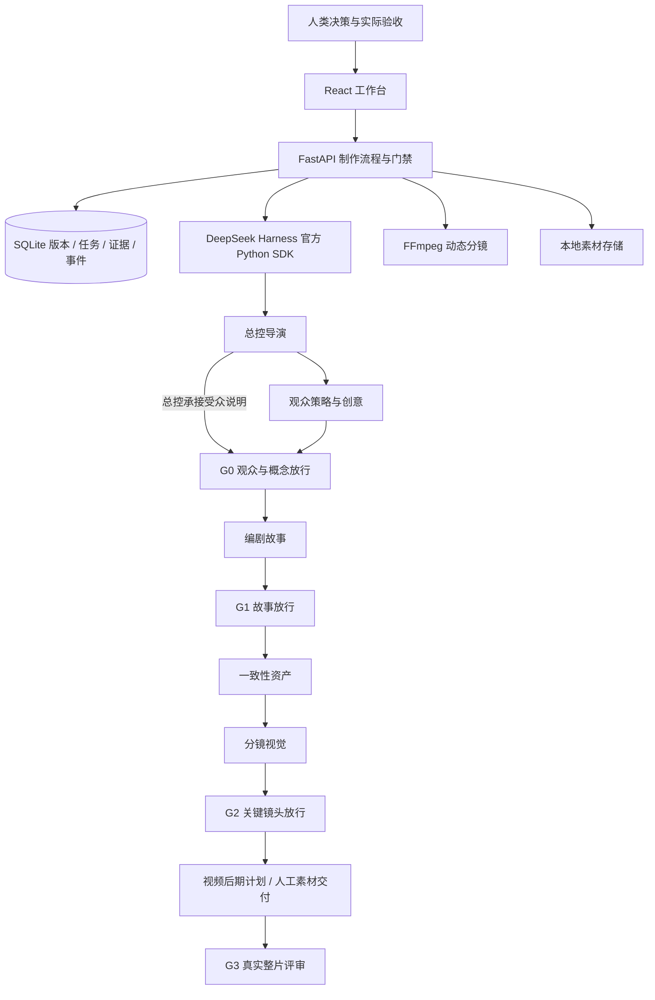

# 映序 · AI 短片制作工作台 v0.1

[](LICENSE)

面向「情绪故事短片」等初期创作，把六角色专业分工、关键假设、参考迁移、版本和人工验收组织在一个本地工作台。

这是可运行的制作系统初版。DeepSeek 文本角色接口已实现；Seedream 官方生图、万相官方图生视频、CosyVoice 官方配音已封装，并预留 Seedance 中转站的方舟兼容接口。真实调用需用户配置凭证；分镜讨论可在授权的本轮素材额度内直接生成或建立图片队列，手动媒体入口保留估价后确认。支持手动成果提交、素材导入和真实 FFmpeg 动态分镜导出。示例全部标记待验证，没有伪造生成结果、观众证据或转化数据。

媒体生成第一步：打开「运行设置」，填写火山方舟和阿里云百炼北京地域的 Key，点「保存媒体 API 配置」。随后到「分镜与素材」填写描述、选择参考图，先估算费用，再确认生成。保存和估算均不请求供应商。Seedance 支持方舟兼容和 OpenRouter 协议；OpenRouter 使用 `bytedance/seedance-2.0` 等完整模型名，设置中可测试已保存的连接（只查询，不生成）。它按模型 SKU 以美元计费，元/秒只作为用户预算参考。其他协议需要另行适配。详见 [媒体 API 与使用说明](docs/media-api.md)。

图片替换：在分镜回复、图片队列总览或「分镜与素材」的图片旁点击「上传替换」，选择 PNG/JPG/WebP（最多10MB）。新图沿用原素材ID，预览自动更新，原图文件与历史版本保留。上传不调用供应商、不占生成预算、不改写原生成账单。未验收的分镜讨论可继续使用新图；已验收方案、引用旧图生成的素材和镜头会提示复查，正在执行的旧队列可能暂停，不会自动重试。

返回修改与同步：在「Agent 工作流」选择原角色，点击「修改本阶段设定」，继续沿用历史对话修改。得到新方案后点击「确认修改并同步其他 Agent」。同步会保存新版成果、发送变更说明，并在相关角色标签上显示「收到修改 · 待更新」；其他角色的下一轮讨论会收到最新确认的正文和版本。上游未确认时可以先讨论下游调整，但不能验收或生成媒体。同步本身免费，不自动调用各角色、不重新生成原有图片和视频；后期文字修改仍不能替代真实成片验收。

## 启动

首次安装需要 Windows、Python 3.12 和 Node.js 22+。克隆仓库后进入项目目录，运行：

```powershell
git clone https://github.com/FTL99/yingxu.git
cd yingxu
python -m venv .venv
./.venv/Scripts/python.exe -m pip install -r requirements.lock.txt
npm ci --prefix frontend
npm run build --prefix frontend
powershell.exe -NoProfile -ExecutionPolicy Bypass -File .\start.ps1
```

启动脚本会打开 **http://127.0.0.1:8811/**。首次安装后，在项目目录运行以下命令即可再次启动；运行窗口可以最小化，停止服务可按 `Ctrl+C`。默认仅监听本机，不支持多人联网部署。

```powershell
powershell.exe -NoProfile -ExecutionPolicy Bypass -File .\start.ps1
```

不自动开浏览器：

```powershell
powershell.exe -NoProfile -ExecutionPolicy Bypass -File .\start.ps1 -NoBrowser
```

重新构建前端可使用 `start.ps1 -Build`（先停止已有服务）。使用 npm 锁文件及 Python 固定版本；SDK 当前是预发布版本，升级须复跑合同、初始化和权限检查。FFmpeg 使用 `imageio-ffmpeg` 的随包程序，无需另装系统 FFmpeg。API Key 在启动后的「运行设置」填写；仓库不包含账号、Key、私人项目、图片或视频。

## 第一次使用

批量出图：在「分镜 / 视觉」讨论里点击「准备批量出图」并发送，或直接说「把已确认分镜需要的图片加入队列，全部生成后给我总览」。一批最多50张，先核对整批估价，再逐张生成；同一窗口显示进度和所有结果，点击图片放大。可以暂停、继续剩余图片、取消剩余图片。失败/限流会暂停，继续不会重试失败项；重启后队列也会暂停，不重复提交已有任务。整批共用本轮素材额度，只有实际提交的图片占用预算；最终质量仍由你查看确认。

当前主入口是「Agent 工作流」中的角色对话：选总控导演，在「告诉 Agent 你的想法」里提问、选择或要求修改。已有回答会带入上下文，Markdown表格可横向滚动。谈妥后，阅读确认区的未验证事项，按需勾选风险确认，再点 **「无异议，确认并交接」**：工作台保存并验收最新完整回复、记录阶段决定，自动切到下一位并发起一轮接棒回复。当前方案保存不调用模型；接棒回复按页面所示额度预留一轮费用，后续阶段仍等你确认。顶部角色标签保留。旧的单独整理、定稿、验收操作折叠在高级操作区。聊天中的「同意」本身不会修改任务状态。

总控确认区默认勾选「由总控承接受众说明，确认后直接交给编剧」，适合当前跳过观众校验的安排；取消勾选则保留独立观众策略环节。合并仅适用于尚未执行的任务，保留原节点和合并记录，不伪造观众验收。下游收到Brief、全部已验收祖先成果的准确版本、确认时讨论、候选记录、预算和未验证事项，不再只有直接上游的一份报告。

编剧场景清单使用三张表：场景与剧情、声音与制作风险、叙事作用。原先S1/S2逐段堆字段的回答会在对话中自动整理为表格，只改变显示、不重写保存的剧本或重新调用模型；表格支持左右滚动及键盘方向键查看完整列。新回复的对话和单次运行均附加同样格式要求，既有任务版本继续有效。陌生或未完整的旧格式保持原文。

观众视频校验当前明确禁用，观众角色保留文字策略与创意讨论。当前模型未读取任何媒体内容，不能声称看过视频或验证了关注/转化；G0 是人类接受策略方案，不等于观众行为已验证。真实人工反馈仍可记录。状态通过 `/api/capabilities` 和项目快照公开，没有启用开关。Gemini 视频 API 已封装，仍被能力策略拦截；未做真实调用。

在「运行设置」顶部填写 **Gemini API Key**，点击「保存 Gemini 配置」。这与 DeepSeek 独立，Key 仅存本机 `data/gemini-settings.json`；留空保留已有 Key，也可勾选清除。保存不会验证 Key、上传素材、产生费用或启用视频评审。文字角色仍使用原 DeepSeek 配置。默认 Gemini 模型为 `gemini-3.8-flash`、1fps、最大输出3072 token、超时120秒；可展开高级配置修改参数。

1. 新建项目，写下观众、内容承诺、目标行为及后续价值。也可以点击「探索示例项目」，建立明确标注的「最后一盏灯」示例。
2. 在「假设与实验」登记高损失假设，把直觉、模型推演、参考观察、观众反馈、行为数据、工具实测分开。先写测试条件，再记录实验；实验不会自动证明假设。
3. 在「Agent 工作流」建立六角色任务。在「运行设置」填写并启用 DeepSeek，开始与总控讨论；无 Key 时可人工提交成果。
4. 方案无异议后点击「无异议，确认并交接」，自动接入下一角色。存在未验证事项时先明确确认风险；也可展开高级操作单独审核或退回。
5. 确认交接同步记录相应G0–G2阶段决定；「验收与放行」保留独立审核入口。接受风险不改变假设证据状态；G3仍要求真实成片五项人工评审。
6. 故事和资产通过后，在「分镜与素材」维护角色/场景/风格 Bible、导入素材、安排镜头，导出 MP4 动态分镜、SRT 和素材版本清单。

项目创意确认覆盖的是实际展示的内容和明确风险，不代表自动认可所有后续实现。最终交付由总控组织；具体缺陷、漏检和假设被反证分开追踪。

## 架构与配合



六职责各自有提示词、任务、输入快照、成果和会话。运行器最多并行两项独立工作，依赖须先验收；人类确认交接后，由后端自动启动一轮下游接棒回复，不无限重试。总控模型负责收敛方向、明确规格和验收约束；工作台负责落实版本、门禁、任务依赖和交接。角色模型返回严格JSON合同中的文本成果和候选记录，不能仅凭一句「已放行」修改工作流。下游通过批准的版本成果及其讨论快照协作。

两份设计文件通过 `studio/prompts.py` 合并为每角色一份生效提示词，严格保留 Goal、Role、User、Info、Rules、Format 六个顶级要素；运行界面可查看生效文本与哈希版本。任务记录创建时的提示词版本；运行前若变化则要求新建任务。

关键文件：

| 文件 | 用途 |
|---|---|
| `studio/app.py` | 本机 API、状态流转、阶段门禁、执行意图与验收 |
| `studio/store.py` | SQLite 事务、乐观锁、依赖失效、幂等与中断恢复 |
| `studio/models.py` | 请求和角色结果数据合同 |
| `studio/prompts.py` | 六项提示词的 v1 + v2 合成 |
| `studio/runtime.py` | 官方 Harness SDK、隔离目录与受限角色运行配置 |
| `studio/chat.py` | 持久化角色讨论、逐轮费用、显式定稿与交接 |
| `studio/handoff.py` | 全部祖先成果版本、确认讨论及未验证事项的交接包 |
| `studio/media.py` | 本地素材的真实动态分镜渲染 |
| `frontend/src/main.tsx` | 工作台界面和制作操作 |
| `frontend/src/RoleConversation.tsx` / `MarkdownView.tsx` | 对话界面与安全Markdown/GFM表格渲染 |
| `tests/test_workflow.py` | 状态、权限、费用与媒体文件验证 |

## 版本、证据与阶段

- 记录按项目、类型、ID、版本保存；编辑产生新版本，历史入口 `/api/projects/{id}/records/{kind}/{record_id}/history`。Brief 单独用 revision。
- 引用须指向当前、未过期版本，禁止跨项目或循环依赖。修改参考、资产、成果、假设或撤销阶段决定会沿已记录的依赖标记下游复查。没有记录依赖的手工内容无法自动推断影响，创建时应选择相关输入。
- G0 需要受众、内容承诺、后续价值、关键假设和已验收的观众策略成果；观众策略由总控正式承接时，改用总控成果。G1需要编剧成果和有效G0；G2需要分镜成果和有效G1；G3需要真实视频附在后期成果上、五项人工验收和有效G2。文字确认不证明成本可行；当前项目约定的两个最贵镜头实测仍须在批量生成前完成。
- **G2 初版由人类记录工具实测依据和保留风险，后端尚未自动核验媒体供应商实测真实性。** 流程放行不是观众有效性的保证。G3 人工检查画面一致性、声音节奏、字幕信息、时长画幅、目标行为和后续价值；初版未接自动视觉/音频评审。
- 验收记录引用本次成果准确版本。失败或未验证的检查不能批准，不确定项须显式确认。模型生成不自动验收；模型候选假设导入后强制保持待验证。
- 改动关键输入后建立局部返工任务；旧任务和会话保留。当前不自动把过期输入替换成新版本，以免悄悄改变任务含义。

## Harness 接入与费用

使用官方 [deepseek-ai/deepseek-harness](https://github.com/deepseek-ai/deepseek-harness)，Python SDK `0.1.5rc1` 和同版 Windows runtime。

遇到 `max-tokens` 表示回答达到长度上限，尚未完整结束。在导演卡片点「查看未完成草稿」可以读到实际输出；「手动补齐」将草稿带入编辑框，保存后仍需验收。「重新生成」仅在你确认发送后产生新请求；保留原会话和待核账费用，只将未运行的下游草稿连接到新任务。下游已有执行记录时须局部返工。默认输出上限为16384 token、思考强度low，高级设置可调整；更高上限仍可能截断并增加费用。

「手动填写成果」用于导入其他工具的答案或自行补充，正常使用顺序是：运行 Agent → 查看成果 → 验收。建立了项目后，工作流内部不会再出现「新建项目」；另建短片从项目切换入口进入。未完成输出只恢复可见答案，不展示思考块、凭证或请求头，也不自动成为成果。

每次任务使用独立 `dsh_home`、工作目录和持久会话 ID。`sdk-minimal` profile 的 shell/终端/子进程工具全部显式禁用，角色只能消费后端提供的上下文。此 profile 不暴露文件、浏览或子 Agent 工具；原生 SDK 启动验证已通过，未做真实付费推理。媒体路径是元数据，当前没有自动发送图像、视频或音频内容给文本角色。

运行前事务保存意图、输入版本和费用预留；同请求 ID 的重放不会再次发模型请求。成功仅进入待验收。失败、超时或进程重启保留「中断」状态，绝不自动重放未知外部操作；核对原会话后人工提交成果或新建任务。任务目录中的 JSONL 为 Harness 自身会话文件，不通过 UI 自动展示隐藏推理。

**预留额度不能限制供应商实际收费。** 当前费用按用户账单证据手工核对；未知费用占用预留，真实费用可超过预留并阻止新的预算不足任务。没有厂商账单 API 或精确费用硬限额。页面不预设收费操作，加载项目不会触发模型调用。

## 数据与凭证位置

- `data/studio.sqlite3`：项目、所有记录历史、任务、费用、操作事件、导出状态和幂等请求。
- `data/media/{project_id}`：上传素材与导出文件。允许 PNG/JPG/WebP/MP4/MOV/WAV/MP3，单个最多100MB；由后台分配文件名，校验图片或媒体解码。来源/许可可编辑并保留版本。
- `data/task-inputs/{task_id}.json`：该次模型调用的生效提示词和上下文快照。
- `data/harness/{task_id}`：Harness 工作目录、profile patch 与会话。
- `data/runtime-settings.json`：运行配置和本地凭证。API 永不回传 Key；也支持 `DEEPSEEK_API_KEY` 环境变量。此初版是当前 Windows 用户的本机工具，本地配置尚未使用系统凭证库加密。
- `data/media-settings.json`：独立的火山方舟、阿里云及 Seedance 中转站凭证和参数。Key 留空保留，勾选清除才删除；保存不验证账号。`data/gemini-settings.json` 保存独立 Gemini 配置，观众视频校验仍禁用。

`data/` 和 `.env*` 均已忽略。备份应在停止服务后复制整个 `data` 目录；它包含私有素材与凭证，备份要按本机用户数据管理。

## 动态分镜导出边界

可导入实际图片/视频，或使用描述生成的规划卡；按镜头时长缩放、补边、拼接为真实 H.264 MP4。默认输出 720×1280 / 1280×720 / 720×720，24fps；单镜最多60秒、全片最多300秒。MP4 读回校验帧及实际时长。

当前导出默认保留视频首条原声音轨，无音轨素材补静音；可选择一条本项目音频叠加旁白，调节原声/旁白音量和旁白开始时间。短视频保持末帧，声音不循环；超出片长的旁白截断。字幕保存为独立 SRT，未烧录。Manifest 保存镜头版本、素材 ID、时长、音轨使用情况和混音参数。本地卡片明确标注规划用途。导出仍是实验小样，声画同步与听感需人工试听。

未实现：其他文字角色直接调用媒体工具、批量视频生成、音乐检索、自动安排旁白时间线、自动压低原声、多轨编辑与音频分离、自动版权核验、RAG/外部资料库、真实观众实验、平台发布、量化行为归因、多用户/云部署。数据库先用 SQLite 和本地文件；向量检索应在有真实参考集合后按需求添加。当前媒体生成成功会入库，仍需人工选择、检查一致性和核账。

## 分镜讨论直接生成（2026-10-04）

进入「Agent工作流」的「分镜 / 视觉」，直接说“先生成开场风格帧给我看”，或“用这张图生成4秒视频，带环境声与音效”。无需转到素材页逐项填写。发送前设置「本轮素材预留上限」（默认10元，0元只讨论）；额度仅在实际生成时占用，未使用部分不扣留。每轮最多两个外层动作；批量图片可通过一个队列动作安排最多50张，后台逐张生成并展示总览。已有任务预算和阶段依赖继续有效。

图片和可播放视频自动显示在对应回复下面，结果同时进入素材库。可继续反馈、修改、读取原结果，在聊天里取回中断的视频或核账。声音仍需对应协议、模型支持和有声预算参考价。自动交接开场和整理定稿只讨论，不自动生成。

实现为工作台受控执行的结构化 `media_actions`，不是开放SDK shell或给模型API Key。供应商调用沿用持久媒体任务与预算、配置、输入版本核对；未知结果不自动重发付费请求。模型只收到素材元数据和任务状态，质量仍需你查看或试听；Gemini视频校验保持禁用。

## 验证

```powershell
./.venv/Scripts/python.exe -m pytest -q
./.venv/Scripts/python.exe scripts/check_harness.py
npm run build --prefix frontend
```

测试覆盖项目创建幂等、证据来源校验、准确版本验收、放行和撤销传播、并发乐观锁、循环依赖、Brief 失效、默认禁用模型、执行意图与预算预留、中断恢复、核账、上传校验、防跨站写入、真实 MP4/SRT、最终成片五项验收、六项提示词和 Key 不回传。另使用本地预设 SSE 响应验证官方 SDK 完整收发、严格 JSON 结果和工具禁用。费用/模型测试使用明确测试替身；它不证明真实服务的质量、费用或延迟。实际记录见 `docs/validation.md`。

## 许可证

本项目源码使用 [MIT License](LICENSE)。第三方依赖、模型服务及用户导入或生成的图片、视频、音频遵循各自的许可证、服务条款和授权范围；本仓库的 MIT 协议不替代这些授权。
